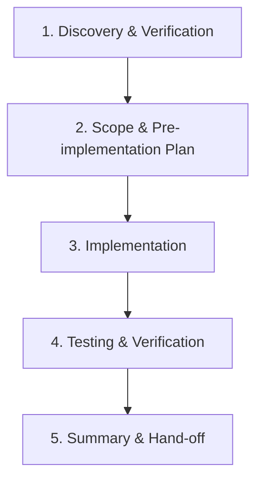

# StudyCollab Backend Issue Implementation

This skill guides the implementation of **exactly one GitHub issue at a time** in the StudyCollab backend. Follow this disciplined workflow step by step. Do not skip phases or combine multiple issues.

---

## Workflow Checklist



---

## 1. Before Coding: Discovery & Verification

Before modifying any file:

1. **Read Issue & References**:
   - Read the selected GitHub issue (e.g. from `.gemini/antigravity-ide/brain/.../github_issues.md` or issue tracker).
   - Check related audit documentation or architecture notes for background context.
2. **Inspect Current Code**:
   - Read every class and config file related to the issue.
   - Verify the problem in the active code. If the issue is ambiguous, already resolved, obsolete, conflicts with existing logic, or depends on an unfinished prerequisite issue, **stop and notify the user before proceeding**.
3. **Verify Git Environment**:
   - Check working tree status and branch:
     ```powershell
     git status
     git branch --show-current
     ```
   - **Branch rule**: Stay on the existing `refactor-backend` branch. **Never create, switch, or delete branches.** Ensure the working tree is clean or in an expected state before starting work.
4. **Propose the Plan**:
   - Identify affected files and expected changes.
   - Explain the approach briefly to the user before editing code.

---

## 2. Scope & Guardrails

- **Single-Issue Focus**: Address only the selected issue. Do not bundle unrelated cleanups, opportunistic refactoring, style reformatting, or dependency upgrades.
- **Backend Only**: Do not touch frontend code (`frontend/`) unless explicitly requested by the user.
- **Dependencies**: Do not add new external libraries or Maven dependencies unless specifically required by the issue description.
- **No Git Lifecycle Actions**: Never run `git commit`, `git push`, create PRs, merge, or close GitHub issues unless explicitly instructed by the user.

---

## 3. Architecture & Coding Conventions

Adhere strictly to StudyCollab's established Spring Boot 3 / Java 21 architecture:

- **Thin Controllers**: Controllers handle HTTP mapping, request validation (`@Valid`), and return standard response wrappers / HTTP status codes. No database calls, business logic, or authorization rules directly in controllers.
- **Service Layer**: Business logic, domain rules, and transactional boundaries (`@Transactional`) belong in service classes.
- **Data Access**: Spring Data JPA repositories with standard naming conventions. Write explicit JPQL/native queries only when necessary.
- **DTOs & Mapping**: Do not expose internal JPA entities directly across HTTP boundaries where DTOs are expected. Maintain consistent validation annotations (`@NotBlank`, `@NotNull`, `@Size`, `@Email`).
- **Preserve Existing Functionality**: Ensure unchanged endpoints, DTO contracts, and client expectations remain backward-compatible unless breaking changes are explicitly part of the issue.

---

## 4. Security Principles

- **No Secret Leaks**: Never hardcode credentials, secrets, or API keys in code or properties. Use environment variables / property placeholders (`${...}`). Ensure secret files (`.env`, `.env.prod`, etc.) are never tracked.
- **Authorization & Access Control**:
  - Verify group membership, ownership, and role checks (`CREATOR`, `ADMIN`, `MEMBER`) where applicable.
  - Never weaken authorization checks, bypass security filters, or make endpoints unnecessarily public.
  - Ensure method security (`@PreAuthorize`) and global security configurations are functional and backed by necessary security beans.
- **Verified Fixes Only**: Never guess or invent security fixes without inspecting the concrete code and validating the actual vulnerability vector.

---

## 5. Testing & Verification

1. **Add or Update Tests**:
   - Create or update relevant unit tests (JUnit 5, Mockito) and integration tests (`@SpringBootTest`, `MockMvc`, Testcontainers).
   - For security fixes, add regression tests that assert unauthorized access fails (e.g. `401 Unauthorized` or `403 Forbidden`) and authorized access succeeds.
2. **Execute Tests**:
   - Run the targeted test suite using the project build tool:
     ```powershell
     mvn test -pl backend -Dtest=TargetTestClass
     ```
   - If tests cannot be run (e.g., missing local PostgreSQL or external service dependencies), report the exact reason and command attempted.
3. **Report Failures**:
   - If any test fails, analyze the root cause, fix the issue, and re-run.

---

## 6. Review & Hand-off

Once implementation and testing are complete, do not proceed to another issue. Provide a structured review containing:

1. **Summary of Changes**: Concise explanation of what was implemented.
2. **Affected Files**: Clickable markdown links (`[ClassName](file:///path/to/File.java)`) to all modified, created, or deleted files.
3. **Tests & Results**: List of tests executed, newly added test cases, and outcomes.
4. **Remaining Risks / Caveats**: Any edge cases, database migration considerations, or environment-specific requirements.
5. **Issue Resolution Status**: Clear assessment of whether the issue is fully resolved against its acceptance criteria.
6. **Wait for Approval**: Stop and wait for user review and explicit instructions before taking any next steps.
