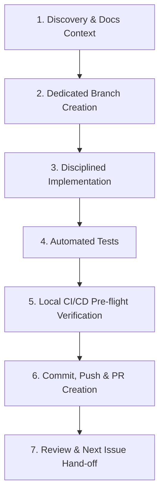

# StudyCollab Issue Runner & Execution Skill

This skill guides the disciplined, end-to-end implementation of **exactly one GitHub issue at a time** in StudyCollab. Follow this step-by-step workflow from discovery through Pull Request creation.

---

## Workflow Lifecycle



---

## Phase 1: Discovery & Documentation Context

Before making any changes:

1. **Resolve GitHub Issue Details**:
   - Fetch the issue using the GitHub CLI:
     ```powershell
     gh issue view <ISSUE-NUMBER-OR-ID> --comments
     ```
   - Note the issue title, acceptance criteria, technical requirements, and related discussion.
2. **Review Relevant Documentation**:
   - For chat issues: Check `docs/CHAT_ARCHITECTURE.md`, `docs/CHAT_API_SPEC.md`, `docs/DIAGRAMS.md`, and `frontend/src/features/chat/README.md`.
   - For product/design standards: Check `PRODUCT.md` and `DESIGN.md`.
   - For backend/frontend standards: Check `README.md` and relevant module files.
3. **Inspect Active Code & Dependencies**:
   - Locate callers, entities, controllers, components, and DTO contracts.
   - Verify existing patterns to match naming conventions and architecture.
4. **Propose Plan**:
   - Outline affected files and approach to the user before editing code.

---

## Phase 2: Dedicated Branch Creation

1. **Check Working Tree**:
   - Check current git status:
     ```powershell
     git status --short
     git branch --show-current
     ```
   - If there are uncommitted changes, do **not** discard them. Ensure they are stashed or committed appropriately with user awareness.
2. **Create Feature Branch**:
   - Create and checkout a dedicated feature branch from the active base branch:
     ```powershell
     git checkout -b feature/<ISSUE-ID>-<short-description>
     # Example: git checkout -b feature/CHAT-01-architecture-docs
     ```

---

## Phase 3: Disciplined Implementation

- **Strict Scope Control**: Implement only what the specific issue requires. Do not perform unrelated refactoring or bundle extraneous dependency changes.
- **Backend Standards (Java 21 / Spring Boot 3)**:
  - Controllers: Thin controllers for routing, request validation (`@Valid`), and HTTP response wrappers.
  - Services: Business logic, transactional boundaries (`@Transactional`), and authorization rules.
  - Security & Authorization: Verify group membership, permissions (`CREATOR`, `ADMIN`, `MEMBER`), and validate JWT principals. Never bypass security checks.
  - Entities & DTOs: Use DTOs for boundary communication; never expose raw entities directly where DTOs are expected. Maintain validation annotations (`@NotBlank`, `@Size`, `@NotNull`).
  - No Secrets: Never commit hardcoded credentials or API keys. Use environment variables and property placeholders.
- **Frontend Standards (React 19 / Vite)**:
  - Clean modular architecture under `src/features/<feature>/`.
  - CSS Modules with tokens defined in CSS variables.
  - Accessible components (ARIA attributes, keyboard navigation).
  - Enforce zero ESLint warnings (`npm run lint`).

---

## Phase 4: Automated Testing

1. **Write or Update Tests**:
   - **Backend**: Add unit tests (JUnit 5, Mockito) and slice/integration tests (`MockMvc`, Spring Security test helpers) for all new services, endpoints, and interceptors.
   - **Frontend**: Add unit and component tests in `frontend/tests/` (testing rendering, user input, state transitions, and edge cases).
2. **Execute Tests**:
   - Run backend tests:
     ```powershell
     $env:JAVA_HOME = "C:\Program Files\Java\jdk-25.0.2"
     cd backend
     .\mvnw.cmd test -Dtest=<TargetTestClass>
     ```
   - Run frontend tests:
     ```powershell
     cd frontend
     npm test
     ```
3. **Enforce Zero Regressions**:
   - Ensure all existing tests in the project continue to pass.

---

## Phase 5: Local CI/CD Pre-flight Verification

Before committing or pushing, mirror the exact GitHub Actions CI/CD pipeline defined in `.github/workflows/ci-cd.yml` locally:

1. **Backend Build & Test Check**:
   ```powershell
   $env:JAVA_HOME = "C:\Program Files\Java\jdk-25.0.2"
   cd backend
   .\mvnw.cmd clean test
   ```
2. **Frontend Quality & Build Checks**:
   ```powershell
   cd frontend
   npm run lint   # Must pass with 0 warnings
   npm test       # All tests must pass
   npm run build  # Production build must succeed
   ```
> **Rule**: Never declare that tests or CI checks pass without actually running them and verifying a successful exit code (0).

---

## Phase 6: Commit, Push & PR Creation

1. **Review Changed Files**:
   - Check `git status --short` and `git diff` to ensure only intended files are staged.
2. **Atomic Git Commit**:
   - Stage relevant files and commit following conventional commits:
     ```powershell
     git add <affected-files>
     git commit -m "feat(<scope>): implement <ISSUE-ID> - <short summary>"
     ```
3. **Push Feature Branch**:
   ```powershell
   git push -u origin feature/<ISSUE-ID>-<short-description>
   ```
4. **Create GitHub Pull Request**:
   - Create PR using GitHub CLI, automatically linking and closing the issue:
     ```powershell
     gh pr create --title "<ISSUE-ID>: <Title>" --body @"
## Summary
<Concise description of changes implemented>

## Issue Reference
Closes #<GITHUB_ISSUE_NUMBER>

## Verification & CI/CD Pre-flight
- [x] Backend tests passed (.\mvnw.cmd test)
- [x] Frontend lint passed with 0 warnings (npm run lint)
- [x] Frontend tests passed (npm test)
- [x] Frontend production build succeeded (npm run build)
"@
     ```

---

## Phase 7: Review & Hand-off

Present a clean completion summary to the user:
1. **Pull Request Link**: Clickable link to the created PR.
2. **Modified / Created Files**: Clickable links (`file:///...`) to all affected files.
3. **Verification Summary**: Summary of test execution and build logs.
4. **Next Step**: Recommend the next sequential issue from the backlog.

