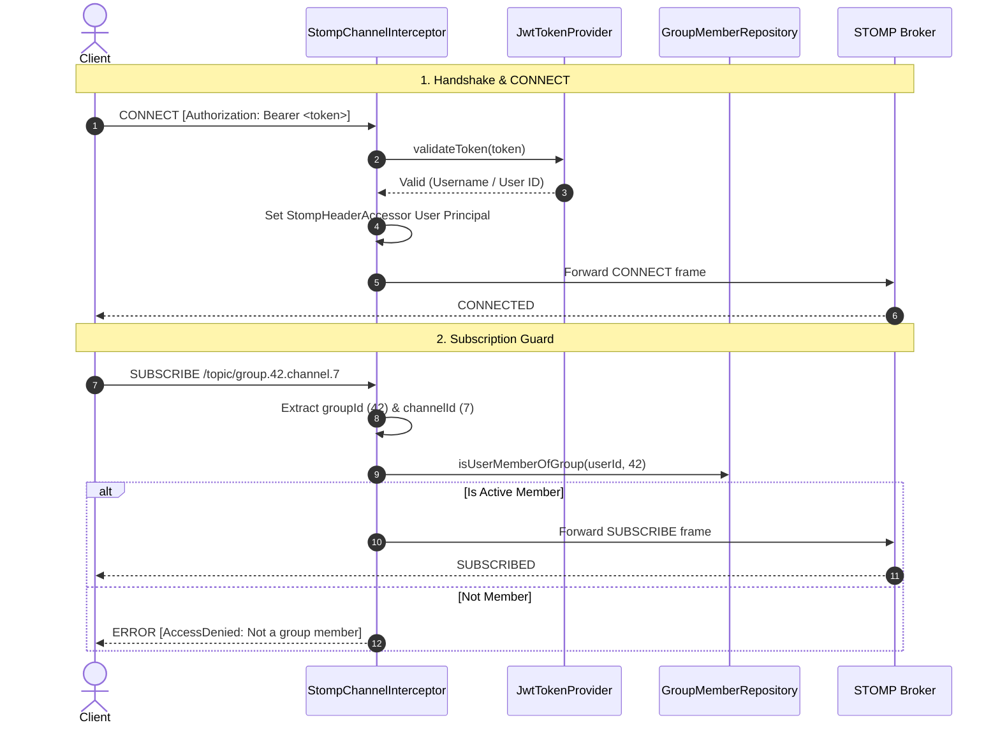
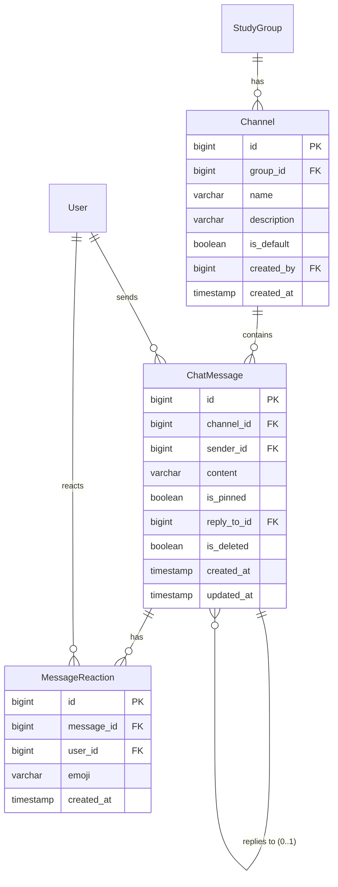

# StudyCollab Real-Time Chat — Architecture Specification

> **Module**: Chat Feature  
> **Status**: Approved Specification  
> **Related Issues**: CHAT-01 (#73) through CHAT-10 (#82)  
> **Last Updated**: November 2026  

---

## 1. System Overview

StudyCollab provides collaborative private workspaces ("Study Groups") for students. The Chat module provides real-time, channel-based communication inside each study group, allowing members to discuss coursework, coordinate tasks, share insights, and organize study sessions without leaving their academic workflow.

```
┌────────────────────────────────────────────────────────┐
│                   React 19 Frontend                    │
│  - ChatPage (Dashboard Workspace Tab)                  │
│  - ChannelList + MessageFeed + ChatInput + MemberList  │
│  - useChat hook (STOMP Client + Keyset History Fetch)  │
└──────────────┬────────────────────────▲────────────────┘
               │ 1. REST (Channels / Cursor History / Pins)
               │ 2. STOMP CONNECT (Bearer JWT in frame headers)
               │ 3. SUBSCRIBE /topic/group.{groupId}.channel.{channelId}
               ▼                        │
┌───────────────────────────────────────┴────────────────┐
│               Spring Boot 3 Backend                    │
│  - WebSocketConfig: @EnableWebSocketMessageBroker       │
│  - StompChannelInterceptor: JWT & Membership Guard     │
│  - ChatController: @MessageMapping inbound handlers    │
│  - ChannelController & ChatMessageController: REST API │
│  - ChannelService & ChatMessageService: Domain Logic   │
└──────────────────────┬─────────────────────────────────┘
                       │
                       ▼
┌────────────────────────────────────────────────────────┐
│                 PostgreSQL Database                    │
│  - channels (id, group_id, name, description, is_default)
│  - chat_messages (id, channel_id, sender_id, content...)
│  - message_reactions (id, message_id, user_id, emoji)  │
└────────────────────────────────────────────────────────┘
```

---

## 2. Real-Time Protocol Specification (STOMP over WebSocket)

### 2.1 Why STOMP over WebSocket?
* **Sub-protocol Semantics**: Simple Text Oriented Messaging Protocol (STOMP) defines standard frame types (`CONNECT`, `SUBSCRIBE`, `SEND`, `MESSAGE`, `DISCONNECT`), eliminating the need to design a custom frame parser over raw WebSockets.
* **Spring Boot Integration**: Native support via `spring-boot-starter-websocket` and `SimpMessagingTemplate`.
* **Frontend Ecosystem**: First-class support via `@stomp/stompjs` with automatic reconnects and queuing.

### 2.2 Connection Handshake
* **Endpoint**: `/ws`
* **Transport**: WebSocket with SockJS fallback support (`.withSockJS()`).
* **Handshake Authentication**:
  STOMP clients include the JWT authentication token in the STOMP `CONNECT` frame header:
  ```text
  CONNECT
  accept-version:1.2,1.1,1.0
  heart-beat:10000,10000
  Authorization:Bearer <JWT_ACCESS_TOKEN>

  ^@
  ```

### 2.3 STOMP Destination Hierarchy

| Type | Destination | Direction | Description |
| :--- | :--- | :--- | :--- |
| **Inbound** | `/app/chat.send` | Client → Broker | Sends a new chat message to a channel |
| **Inbound** | `/app/chat.edit` | Client → Broker | Edits an existing message (author only) |
| **Inbound** | `/app/chat.delete` | Client → Broker | Soft-deletes a message (author or admin) |
| **Inbound** | `/app/chat.react` | Client → Broker | Toggles an emoji reaction on a message |
| **Outbound** | `/topic/group.{groupId}.channel.{channelId}` | Broker → Clients | Channel broadcast topic for new messages, edits, deletions, and reactions |
| **Outbound** | `/user/queue/errors` | Broker → Client | User-specific channel for real-time error messages |

---

## 3. Security & Authorization Architecture

Real-time WebSocket communication operates outside standard Spring Security HTTP servlet filter chains once the connection is established. To ensure robust zero-trust security, authorization is enforced at the STOMP message channel level via `StompChannelInterceptor`.



### 3.1 Security Guardrails
1. **CONNECT Authentication**: Missing, expired, or malformed JWT tokens immediately abort the STOMP connection with an error frame.
2. **SUBSCRIBE Authorization**: Whenever a client issues a `SUBSCRIBE` frame targeting `/topic/group.{groupId}.channel.{channelId}`, the interceptor verifies that the authenticated user belongs to `groupId`. Unauthorized users cannot eavesdrop on private group channels.
3. **SEND Validation**:
   - The user sending to `/app/chat.send` must be an active member of the target group.
   - Message edits (`/app/chat.edit`) verify that `authenticatedUserId == message.sender.id`.
   - Message deletions (`/app/chat.delete`) verify that `authenticatedUserId == message.sender.id` OR user holds `ADMIN` or `CREATOR` role in the group.

---

## 4. Domain Entities & Database Schema

The chat schema integrates with existing StudyCollab entities (`User`, `StudyGroup`):



### 4.1 Channel Seeding Rule
Every newly created `StudyGroup` must automatically instantiate and persist a default `#general` channel (`is_default = true`). The default channel cannot be deleted.

---

## 5. Keyset (Cursor-Based) History Pagination

To support smooth, jitter-free scrolling in active chat feeds, message history uses **keyset pagination** rather than offset-based pagination (`page=0, size=50`):

* **Query Pattern**:
  ```sql
  SELECT * FROM chat_messages 
  WHERE channel_id = :channelId 
    AND id < :beforeId 
  ORDER BY id DESC 
  LIMIT :limit;
  ```
* **Why Keyset?**: When new messages arrive while a user is reading or scrolling up, offset-based queries shift, resulting in duplicate or skipped messages. Keyset cursor pagination by `id` is immune to offset drift.

---

## 6. Frontend State & Resilience Architecture

The frontend client integrates with WebSocket via a dedicated `useChat` React hook:

1. **Lifecycle Management**: Connects on mount, authenticates with current token, switches subscriptions when `channelId` changes, and cleanly disconnects on unmount.
2. **Exponential Backoff Reconnect**: Reconnects automatically on network drops (1s, 2s, 4s, up to 16s max interval).
3. **Optimistic UI Updates**: Outgoing messages are appended immediately with a temporary client ID and marked as `status: 'sending'`. Upon receiving the broker broadcast, the optimistic message is reconciled with the canonical server message.
4. **Offline / Reconnecting State**: A subtle status banner notifies users if the connection is temporarily reconnecting.

