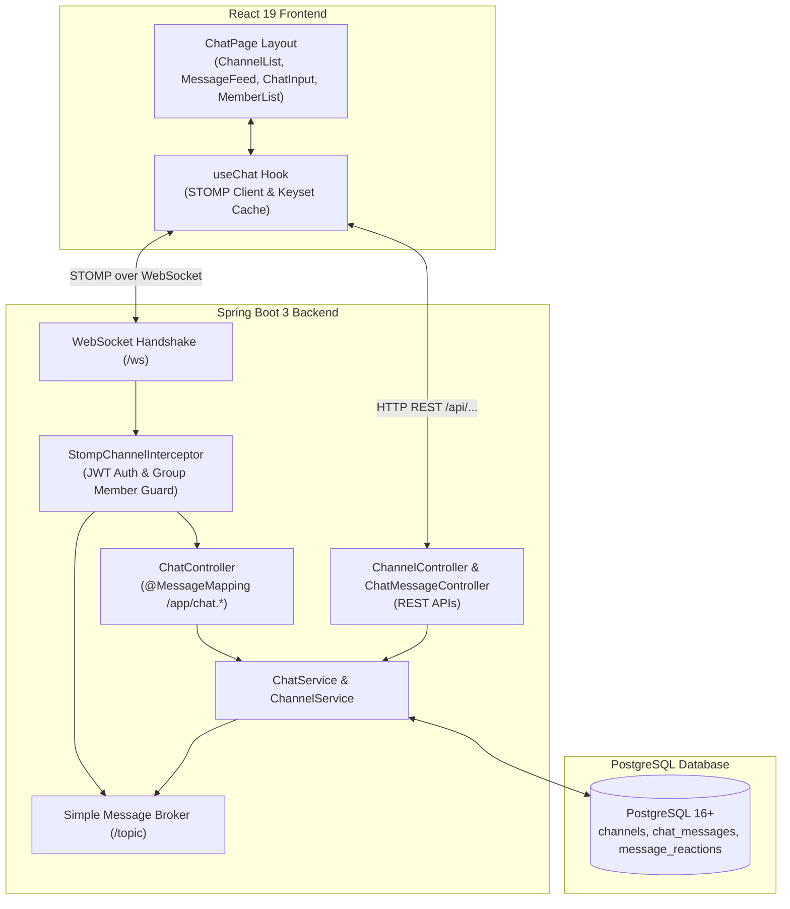
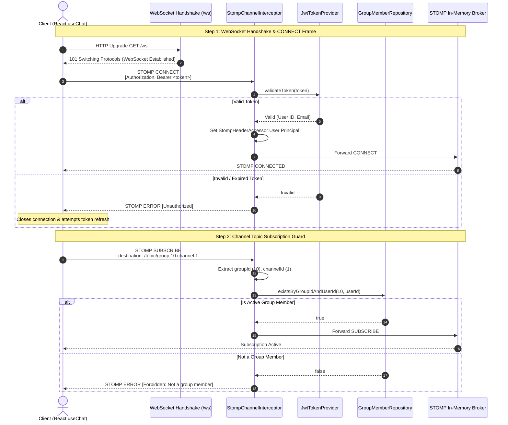
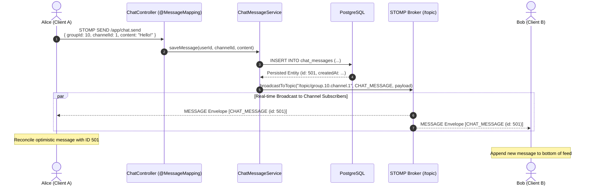
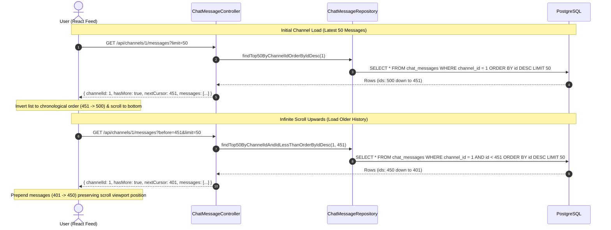

# StudyCollab Architecture Diagrams

This document contains Mermaid diagrams illustrating core system flows and architectures across StudyCollab.

---

## 1. Real-Time Chat System Architecture

---

## 2. STOMP Connection & Subscription Guard Sequence

---

## 3. Real-Time Message Dispatch & Broadcast Sequence

---

## 4. Keyset (Cursor-Based) History Loading Flow

